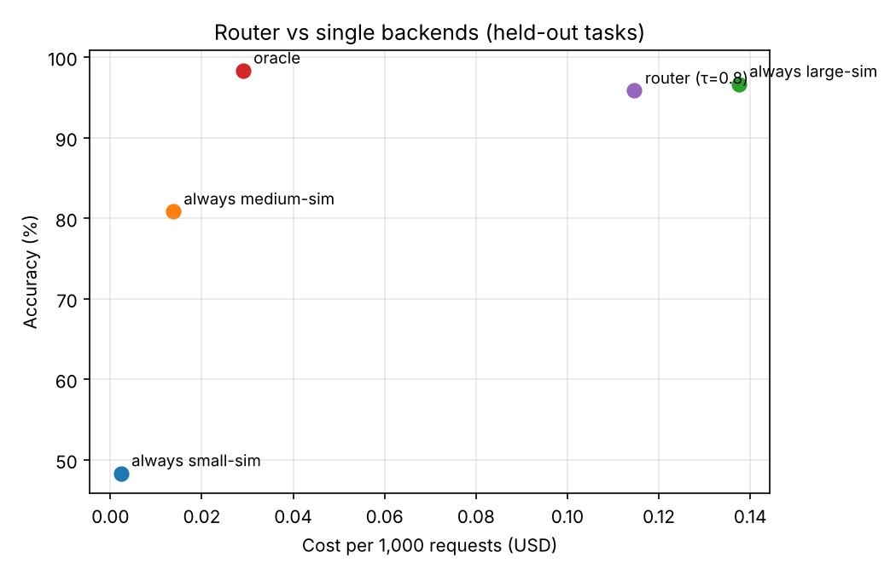

# 🧭 RouteWise: LLM Inference Benchmark & Cost-Aware Router

[](https://github.com/indrareddyds009-source/routewise/actions)

**Question:** for a given workload, which model should serve each request, and what does
that choice cost in accuracy, latency and dollars?

RouteWise answers that in two steps:

1. **Benchmark** any set of OpenAI-compatible backends (vLLM, Ollama, llama.cpp, TGI, OpenAI…) on an
   auto-graded task suite, measuring accuracy, time-to-first-token, p50/p95 latency, output tokens/s,
   throughput under concurrency, and **cost per 1,000 requests** (API pricing *or* GPU-hour cost
   amortized over measured throughput, so self-hosted and API models are compared on equal terms).
2. **Learn a router** from those results: per-backend classifiers predict *"will this model get this
   prompt right?"*, and the router sends each prompt to the cheapest model likely to succeed,
   escalating otherwise. It's evaluated by offline replay on held-out tasks against "always use model X"
   and an oracle, then served behind an **OpenAI-compatible gateway** (`model="auto"`).

## How it works

```
 task suite (generated, auto-graded)
        │
        ▼
 bench.py ── async streaming client ──▶ backend A (e.g. Qwen 0.5B, Ollama)
        │    (TTFT, latency, tokens,  ──▶ backend B (e.g. Llama 3.2 3B)
        │     cost, correctness)      ──▶ backend C (e.g. GPT-4o-mini / vLLM 7B)
        ▼
 results.jsonl ──▶ report.py   → accuracy by type/difficulty, latency, throughput, cost, Pareto chart
              └──▶ router.py   → TF-IDF + prompt-stat logistic classifiers per backend
                                 → τ-sweep → pick cheapest τ within 98% of best accuracy
                                 → router.joblib ──▶ gateway.py (OpenAI-compatible, model="auto")
```

**Task suite.** 5 task families × 3 difficulty levels, generated procedurally with exact answers:
arithmetic, multi-step word problems, invoice field extraction to JSON (with decoy amounts at the hard
level), date arithmetic / weekday, and letter counting (a known weakness of small tokenized models).
Generated tasks mean no data-contamination or licensing issues, and graders are deterministic, so no
LLM-as-judge noise. Bring your own tasks with `--tasks file.jsonl`.

## Run it

```bash
pip install -r requirements-dev.txt
pytest -q                                   # 66 tests, including end-to-end against a simulator

# 1) Real run on a laptop (free): two open models via Ollama + GPT-4o-mini
ollama pull qwen2.5:0.5b && ollama pull llama3.2:3b
export OPENAI_API_KEY=sk-...
python -m routewise.bench  --config configs/local_ollama_openai.yaml --n 300 --concurrency 4 --out results/run.jsonl
python -m routewise.report results/run.jsonl --out-dir results
python -m routewise.router train results/run.jsonl --out results/router.joblib

# 2) Serve the router
ROUTEWISE_CONFIG=configs/local_ollama_openai.yaml ROUTEWISE_ROUTER=results/router.joblib \
  uvicorn routewise.gateway:app --port 9000
curl localhost:9000/v1/chat/completions -H 'Content-Type: application/json' \
  -d '{"model":"auto","messages":[{"role":"user","content":"What is 48 * 77?"}]}' -i | grep x-routewise
```

GPU variant (vLLM, FP16 vs AWQ 4-bit vs a smaller model) is in `configs/vllm_gpu.yaml`; a single cloud
L4/A10G for about an hour is enough.

## Results

> **TODO: fill in from your own run** (`results/report.md`, `results/router_report.md`).
> Do not copy the simulated numbers below into a resume.

| Backend | Accuracy | p50 latency | p95 latency | Tokens/s | Cost / 1k req |
|---|---|---|---|---|---|
| … | … | … | … | … | … |

| Policy (held-out tasks) | Accuracy | Cost / 1k req |
|---|---|---|
| always … | … | … |
| router (τ=…) | … | … |
| oracle | … | … |

### Pipeline demo on the built-in simulator

`python -m routewise.simulator` serves three fake models with known accuracy/speed/price profiles so
the whole pipeline (streaming, grading, reporting, router training, gateway) runs in CI without a GPU.
Its numbers are synthetic by construction: see [`docs/simulated_demo/`](docs/simulated_demo/).



## Design notes

- **Cost model.** API backends: tokens × list price. Self-hosted: `gpu_hourly_usd × wall_time / requests`
  at the measured concurrency, so batching gains from vLLM show up as lower cost per request.
- **Router evaluation is leakage-safe.** Train/test split is by task, and the threshold is picked on the
  test curve only for reporting. Use `--target` to change the accuracy floor (default 98% of the best single backend).
- **Failure handling.** Timeouts and HTTP errors are recorded per request (`error` column) and count as
  incorrect, rather than crashing the run.

## Project layout

```
routewise/
  tasks.py      generated task suite        grading.py  deterministic graders
  backends.py   config + streaming client   bench.py    concurrent benchmark runner
  report.py     summary tables + Pareto     router.py   train / replay-evaluate router
  gateway.py    OpenAI-compatible routing proxy
  simulator.py  fake OpenAI-compatible server for tests/CI
configs/        simulated, Ollama + OpenAI, vLLM GPU
```

## License

MIT
