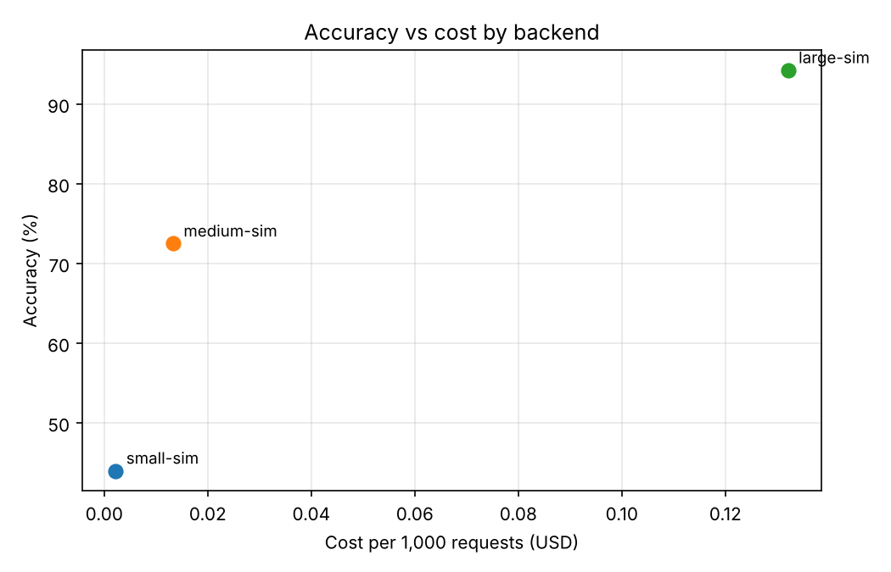

# Benchmark report (SIMULATED backends: pipeline demo only, not real model results)

Requests: 1200 · Backends: 3 · Concurrency: 16

## Summary

| backend    |   accuracy |   p50_latency_s |   p95_latency_s |   p50_ttft_s |   out_tok_per_s |   req_per_s |   cost_per_1k_usd |   errors |
|:-----------|-----------:|----------------:|----------------:|-------------:|----------------:|------------:|------------------:|---------:|
| small-sim  |     0.44   |          0.0312 |          0.0819 |       0.0244 |        283.11   |     355.109 |            0.0022 |        0 |
| medium-sim |     0.725  |          0.0535 |          0.1452 |       0.0434 |        163.928  |     214.536 |            0.0133 |        0 |
| large-sim  |     0.9425 |          0.1045 |          0.2966 |       0.083  |         80.1775 |     108.882 |            0.1321 |        0 |

## Accuracy by difficulty

| backend    |   easy |   hard |   medium |
|:-----------|-------:|-------:|---------:|
| large-sim  |  0.978 |  0.91  |    0.939 |
| medium-sim |  0.934 |  0.459 |    0.779 |
| small-sim  |  0.787 |  0.068 |    0.458 |

## Accuracy by task type

| backend    |   arithmetic |   counting |   date |   extraction |   word_problem |
|:-----------|-------------:|-----------:|-------:|-------------:|---------------:|
| large-sim  |        0.938 |      0.9   |  0.938 |        0.988 |          0.95  |
| medium-sim |        0.725 |      0.612 |  0.8   |        0.738 |          0.75  |
| small-sim  |        0.538 |      0.288 |  0.375 |        0.562 |          0.438 |

